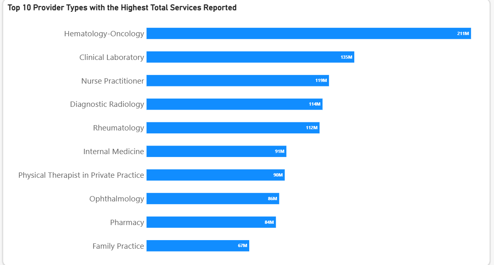
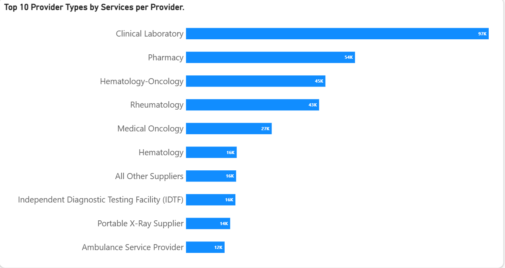
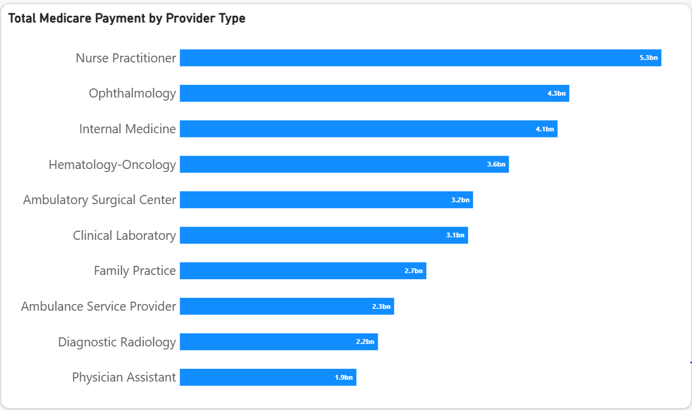

# Medicare Healthcare Utilization Analysis — 2024
--- 

--- 
## PROJECT OVERVIEW
---
This project explores healthcare utilization and Medicare expenditure patterns using the 2024 Medicare Physician & Other Practitioners dataset published by the Centers for Medicare & Medicaid Services (CMS).

The analysis examines how Medicare providers, reported beneficiary volume, healthcare services and Medicare payments are distributed across provider specialties and geographic locations in the United States.

I used MySQL for data exploration, cleaning, validation and analysis, and Power BI to develop an interactive dashboard that presents the findings.

The project focuses on understanding the relationship between provider availability, service utilization and Medicare expenditure, while identifying differences across provider types and states.

## PROBLEM STATEMENT
--- 

Healthcare utilization and provider availability can vary considerably across geographic locations and medical specialties. Understanding these variations can provide useful insights into healthcare resource distribution and how Medicare spending is allocated.
The analysis sought to answer the following questions:

- How does the *Total Services reported* and the *Unique Provider count* vary per state?

- Which *10 provider types* have the highest reported beneficiary volume?

- What are the *Top 10* Provider types with the highest Total Services reported?

- Which Provider Types has the highest Service per Provider?

- How does the Total Medicare Payment vary across provider types?

 ## OBJECTIVES
--- 
- Assess the quality and completeness of the dataset.

- Compare provider counts and reported service volume across provider types.

- Examine geographic differences in reported service volume across states.

- Calculate average reported services per provider.

- Explore how reported beneficiary counts and Medicare payments vary across provider categories.

- Communicate findings and data limitations through an interactive Power BI dashboard.

## DATASET
---
- Source: Centers for Medicare & Medicaid Services (CMS)

- Dataset: Medicare Physician & Other Practitioners – 2024

- Records: Approximately 669,587 provider records

- Geographic coverage: U.S. states represented in the dataset

- Data structure: Provider-level aggregated Medicare utilization and payment information.

The dataset contains information about healthcare providers, their locations, provider specialties, reported beneficiaries, services rendered, submitted charges, Medicare-approved amounts and Medicare payments.

A separate state lookup table was created to map state abbreviations to their corresponding full state names for geographic analysis.

## KEY SKILLS DEMONSTRATED
--- 
### MySQL

- Database creation and management.

- Data exploration using SELECT and DESCRIBE.

- Data quality assessment and validation.

- Aggregations using SUM(), COUNT() and COUNT(DISTINCT).

- Grouping and ranking using GROUP BY and ORDER BY.

- Table relationships using JOIN.

- Calculating services per provider.

- Creating a state lookup table for geographic analysis.

### Power BI

- Data visualization and dashboard development.

- KPI cards for high-level performance indicators.

- Geographic comparisons across states.

- Provider specialty and service utilization comparisons.

- Medicare expenditure analysis.

- Interactive exploration of provider and geographic patterns.

### Analytical techniques

- Descriptive analysis.

- Geographic analysis.

- Provider distribution analysis.

- Specialty-level utilization analysis.

- Financial aggregation and comparison.

- Average services per provider calculations.

## Data Cleaning and Preparation

Before performing the analysis, I conducted data exploration and quality checks in MySQL.

The following steps were undertaken:

1. Database and data exploration

Created the healthdata database.

Imported and inspected the Medicare dataset.

Used DESCRIBE to examine column names and data types.

Reviewed sample records to understand the structure of the dataset.

2. Missing value assessment

Used conditional aggregation to check for NULL values across the dataset's key columns, including provider identification, location, specialty, beneficiary, service and payment fields.

3. Blank value assessment

Used TRIM() to identify empty strings and whitespace in relevant text columns.

These entries were retained rather than arbitrarily replaced because the missing information was not essential to the main utilization and expenditure calculations.

4. Provider validation

Counted total records and distinct NPIs.

Checked for NPIs appearing in multiple records to assess repeated provider entries.

Used COUNT(DISTINCT Rndrng_NPI) when calculating unique provider counts.

5. Geographic standardization

Created a separate state_lookup table containing state abbreviations and their corresponding full names.

Used SQL JOIN operations to connect the lookup table to the Medicare dataset, making state-level analysis and reporting easier to interpret.

## ANALYSIS
--- 
### 1. Data Quality Assessment

Initial SQL checks assessed missing values in the provider, geographic, service, beneficiary, and payment fields.

The initial assessment identified nine NULL values in Rndrng_Prvdr_Last_Org_Name and no NULL values in the core analytical fields checked.

The nine missing organisation-name values were not automatically replaced or deleted because the field was not required for the main dashboard measures.

###  2. Key Performance Indicators (KPI)
--- 
| KPI | Value |
|---|---:|
| Reported Beneficiary Volume | 186 Million |
| Unique Providers | 670,000 |
| Total Medicare Payments | $61.70 Billion |
| Total Services | 2 Billion |

### 3.  Questions Answered And Key Findings
---
#### 1. How does the *Total Services reported* and the *Unique Provider count* vary per state?

---

- California recorded the highest figures among the states highlighted, with 54,355 unique providers and 201,210,977 reported services.

- Florida followed closely in service volume, recording 201,165,452 services from 44,523 unique providers. Interestingly, its total service volume was almost identical to California's despite having fewer providers.

- Texas recorded 44,807 unique providers and 145,370,640 reported services.

- New York had 45,906 unique providers and 104,857,719 reported services.

- Wyoming recorded the lowest provider count among the states highlighted, with 1,221 unique providers and 2,805,749 reported services.

- Vermont had 1,617 unique providers and 2,003,828 reported services.

- California and Florida recorded very similar total service volumes despite a difference of nearly 10,000 providers. This suggests that the number of providers in a state does not necessarily correspond directly to its total service volume. Similarly, states with smaller provider populations generally recorded lower aggregate service volumes in this comparison.

- California: 3,701.79 services per provider.

- Florida: 4,518.24 services per provider.

- Florida therefore had approximately 22% more reported services per provider than California.

- This suggests that a higher provider count does not necessarily translate into a proportionately higher service volume.
  

#### 2.  What are the *Top 10* Provider types with the highest Reported Beneficiary Volume?
  
   
---

- Diagnostic Radiology recorded the highest reported beneficiary volume at 29.8 million, almost twice the volume recorded by Nurse Practitioners (14.9 million).

- Nurse Practitioners and Internal Medicine ranked second and third, with 14.9 million and 11.7 million reported beneficiary counts respectively.

- Clinical Laboratory ranked fourth with 10.4 million, while Cardiology and Physician Assistant both recorded approximately 9.3 million.

- Family Practice and Emergency Medicine recorded 8.6 million and 7.2 million respectively.

- Ophthalmology and Pathology had the lowest reported beneficiary volumes among the top 10 provider types, at 5.5 million and 4.9 million.

Overall observation: Diagnostic Radiology stands out with a substantially higher reported beneficiary volume than the other specialties in the top 10.

#### 3. What are the *Top 10* Provider types with the highest Total Services reported?

---
- Hematology-Oncology recorded the highest total service volume, with approximately 211 million reported services, followed by Clinical Laboratory at 135 million.

- Nurse Practitioners ranked third with 119 million services, while Diagnostic Radiology and Rheumatology recorded 114 million and 112 million respectively.

- Internal Medicine and Physical Therapist in Private Practice recorded 91 million and 90 million services.

- Ophthalmology and Pharmacy recorded 86 million and 84 million services respectively, while Family Practice ranked tenth with 67 million.

- Hematology-Oncology recorded the highest service volume, while Diagnostic Radiology led in reported beneficiary volume in the previous analysis. This difference highlights that provider specialties with the highest reported beneficiary counts do not necessarily account for the highest total service volumes.

 #### 4. Which Provider Types has the highest Service per Provider?

 
 ---

**Key Findings: Average Services per Provider by Specialty**

- Clinical Laboratory recorded the highest average services per provider, at approximately 97,000, considerably higher than all other provider types in the top 10.
  
- Pharmacy ranked second with approximately 54,000 services per provider, followed by Hematology-Oncology (45,000) and Rheumatology (43,000).
  
- Medical Oncology recorded approximately 27,000 services per provider.
  
- Hematology, All Other Suppliers and Independent Diagnostic Testing Facility each recorded approximately 16,000 services per provider.
  
- Ambulance Service Provider had the lowest average among the top 10, at approximately 12,000.

-  Clinical Laboratory had the highest average services per provider despite ranking second in total service volume. Conversely, Hematology-Oncology led in total reported services but ranked third in average services per provider. This highlights the importance of considering provider counts when comparing service utilization across specialties.

  #### 5.  How does the Total Medicare Payment vary across provider types?

  
  ---

- Nurse Practitioners received the highest total Medicare payments among the provider types displayed, accounting for approximately $5.3 billion.
  
- Ophthalmology ranked second with $4.3 billion, followed by Internal Medicine at $4.1 billion.
  
- Hematology-Oncology received approximately $3.6 billion, ranking fourth despite recording the highest total reported service volume in the previous analysis.
  
- Ambulatory Surgical Centers and Clinical Laboratories accounted for approximately $3.2 billion and $3.1 billion respectively.
  
- Family Practice received $2.7 billion, while Ambulance Service Providers and Diagnostic Radiology accounted for $2.3 billion and $2.2 billion.
  
- Physician Assistants recorded the lowest total Medicare payments among the top 10 provider types, at approximately $1.9 billion.

- Nurse Practitioners ranked highest in total Medicare payments, while Hematology-Oncology led in total reported services and Diagnostic Radiology led in reported beneficiary volume. These differences demonstrate that high service volume or beneficiary counts do not necessarily correspond to the highest Medicare expenditure.

 ## Overall Insights

The analysis revealed that Medicare healthcare utilization and expenditure vary considerably across geographic locations and provider specialties.

Some of the key insights include:

- California recorded the highest provider count among the states highlighted, while Florida achieved a nearly identical total service volume with fewer providers.
  
- Diagnostic Radiology had the highest reported beneficiary volume, while Hematology-Oncology accounted for the highest total reported services.
  
- Clinical Laboratory recorded the highest average services per provider, demonstrating that high aggregate service volume and high average service volume are not
  necessarily the same.
  
- Nurse Practitioners accounted for the highest total Medicare payments among the provider types displayed, despite not leading in either total services or reported beneficiary volume.

Overall, the findings demonstrate that provider distribution, reported beneficiary volume, service utilization and Medicare expenditure measure different aspects of healthcare activity. Examining them together provides a more comprehensive understanding of Medicare utilization patterns than relying on any single metric.

##  Limitations

Although the analysis provides useful insights into Medicare provider distribution, service utilization and expenditure, there are limitations to consider when interpreting the findings.

1. **Beneficiary Count Overlap:** The `Tot_Benes` field represents reported beneficiary counts at the provider level. A beneficiary may receive services from multiple providers and therefore appear in multiple records. Consequently, summing this field does not necessarily represent the number of unique Medicare beneficiaries.

2. **Aggregated Data:** The dataset contains provider-level aggregated information rather than individual patient-level records. This limits the ability to investigate individual healthcare journeys, diagnoses, treatment outcomes or patterns of service use.

3. **Geographic Interpretation:** Provider locations represent their recorded practice locations, not necessarily the residential locations of beneficiaries receiving care. Therefore, states with higher service volumes do not automatically have more beneficiaries residing there.

4. **Service Volume Interpretation:** Total services and average services per provider do not independently measure healthcare quality, efficiency or productivity. Differences may be influenced by provider specialty, the nature of services delivered and patient needs.

5. **Medicare Payment Interpretation:** Total Medicare payments represent aggregate payments associated with provider types. They do not indicate individual provider earnings, payment per service or the actual cost of delivering healthcare.

6. **Missing Provider Information:** Some records contained blank provider first names and credentials. Although these fields were not essential to the main analysis, their absence limits certain provider-identification activities.

7. **Limited Time Scope:** The analysis focuses on 2024 data and therefore does not establish whether the observed utilization and expenditure patterns represent long-term trends or changes over time.

8. **No Causal Analysis:** The analysis identifies differences and patterns across states and provider specialties but does not establish the underlying causes of these differences.

## Recommendations

Based on the findings from the analysis, the following areas are recommended for further investigation:

1. **Investigate Geographic Differences in Service Utilization:** Further examine states such as Florida and California, which recorded almost identical total service volumes despite having different provider counts. Comparing their average services per provider could provide additional insight into geographic utilization patterns.

2. **Investigate High Service Intensity Across Specialties:** Clinical Laboratory recorded the highest average services per provider, at approximately 97,000. Further analysis should explore the factors contributing to this high service volume compared with other specialties.

3. **Examine Medicare Payments Relative to Service Volume:** Calculate Medicare payment per service and payment per provider across specialties to better understand differences in expenditure beyond aggregate payment totals.

4. **Incorporate Beneficiary Characteristics:** Use average beneficiary age and risk scores to provide additional context when comparing service utilization across provider types and geographic locations.

5. **Explore Rural and Urban Provider Distribution:** Use the Rural-Urban Commuting Area (RUCA) classifications to investigate differences in provider availability and service utilization between rural and urban locations.

6. **Conduct Further Outlier Analysis:** Identify providers or specialties with unusually high or low service volumes and Medicare payments compared with others in similar categories. These patterns should be investigated further rather than automatically interpreted as inappropriate utilization.

7. **Expand the Analysis Across Multiple Years:** Incorporate previous years of Medicare data to identify changes in provider distribution, service utilization and Medicare expenditure over time.

   
 

