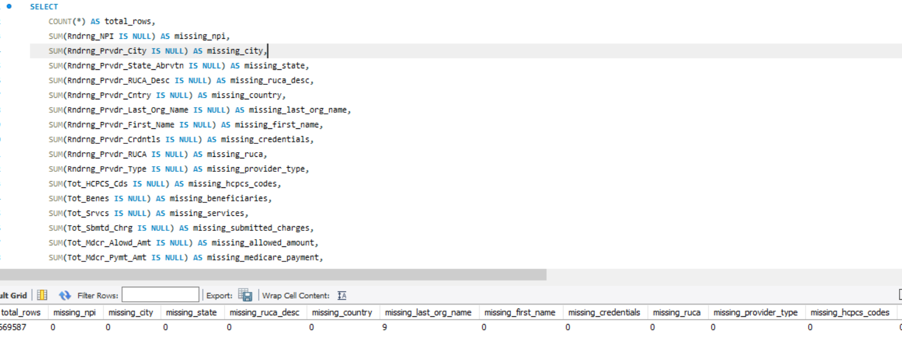
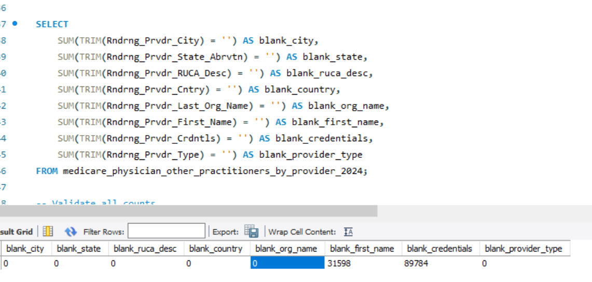
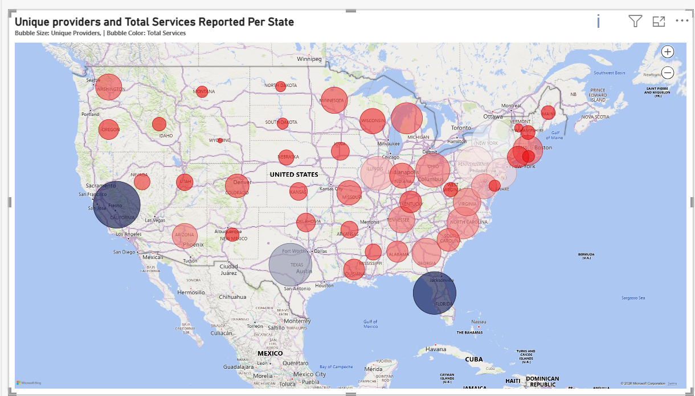
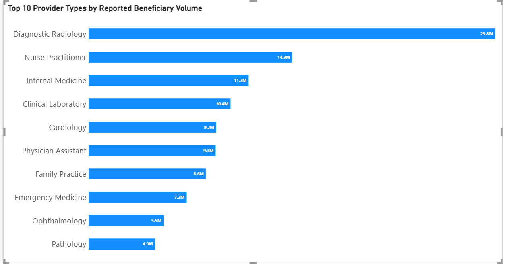

# Medicare Healthcare Utilization Analysis — 2024
--- 

--- 
## PROJECT OVERVIEW
---
This project explores healthcare utilization and Medicare expenditure patterns using the 2024 Medicare Physician & Other Practitioners dataset published by the Centers for Medicare & Medicaid Services (CMS).

The analysis examines how Medicare providers, reported beneficiary volume, healthcare services and Medicare payments are distributed across provider specialties and geographic locations in the United States.

I used MySQL for data exploration, cleaning, validation and analysis, and Power BI to develop an interactive dashboard that presents the findings.

The project focuses on understanding the relationship between provider availability, service utilization and Medicare expenditure, while identifying differences across provider types and states.

## PROBLEM STATEMENT
--- 

Healthcare utilization and provider availability can vary considerably across geographic locations and medical specialties. Understanding these variations can provide useful insights into healthcare resource distribution and how Medicare spending is allocated.
The analysis seeked to answer the following questions:

- How does the *Total Services reported* and the *Unique Provider count* vary per state?

- What are the *Top 10* Provider types with the highest Reported Beneficiary Volume?

- What are the *Top 10* Provider types with the highest Total Services reported?

- Which Provider Types has the highest Service per Provider?

- How does the Total Medicare Payment vary across provider types?

 ## OBJECTIVES
--- 
- Assess the quality and completeness of the dataset.

- Compare provider counts and reported service volume across provider types.

- Examine geographic differences in reported service volume across states.

- Calculate average reported services per provider.

- Explore how reported beneficiary counts and Medicare payments vary across provider categories.

- Communicate findings and data limitations through an interactive Power BI dashboard.

## DATASET
---
- Source: Centers for Medicare & Medicaid Services (CMS)

- Dataset: Medicare Physician & Other Practitioners – 2024

- Records: Approximately 669,587 provider records

- Geographic coverage: U.S. states represented in the dataset

- Data structure: Provider-level aggregated Medicare utilization and payment information.

The dataset contains information about healthcare providers, their locations, provider specialties, reported beneficiaries, services rendered, submitted charges, Medicare-approved amounts and Medicare payments.

A separate state lookup table was created to map state abbreviations to their corresponding full state names for geographic analysis.

 ## KEY SKILLS DEMONSTRATED
--- 
### MySQL

- Database creation and management.

- Data exploration using SELECT and DESCRIBE.

- Data quality assessment and validation.

- Aggregations using SUM(), COUNT() and COUNT(DISTINCT).

- Grouping and ranking using GROUP BY and ORDER BY.

- Table relationships using JOIN.

- Calculating services per provider.

- Creating a state lookup table for geographic analysis.

### Power BI

- Data visualization and dashboard development.

- KPI cards for high-level performance indicators.

- Geographic comparisons across states.

- Provider specialty and service utilization comparisons.

- Medicare expenditure analysis.

- Interactive exploration of provider and geographic patterns.

### Analytical techniques

- Descriptive analysis.

- Geographic analysis.

- Provider distribution analysis.

- Specialty-level utilization analysis.

- Financial aggregation and comparison.

- Average services per provider calculations.

## Data Cleaning and Preparation

Before performing the analysis, I conducted data exploration and quality checks in MySQL.

The following steps were undertaken:

1. Database and data exploration

Created the healthdata database.

Imported and inspected the Medicare dataset.

Used DESCRIBE to examine column names and data types.

Reviewed sample records to understand the structure of the dataset.

2. Missing value assessment

Used conditional aggregation to check for NULL values across the dataset's key columns, including provider identification, location, specialty, beneficiary, service and payment fields.

3. Blank value assessment

Used TRIM() to identify empty strings and whitespace in relevant text columns.

These entries were retained rather than arbitrarily replaced because the missing information was not essential to the main utilization and expenditure calculations.

4. Provider validation

Counted total records and distinct NPIs.

Checked for NPIs appearing in multiple records to assess repeated provider entries.

Used COUNT(DISTINCT Rndrng_NPI) when calculating unique provider counts.

5. Geographic standardization

Created a separate state_lookup table containing state abbreviations and their corresponding full names.

Used SQL JOIN operations to connect the lookup table to the Medicare dataset, making state-level analysis and reporting easier to interpret.

## ANALYSIS
--- 
### 1. Data Quality Assessment

Initial SQL checks assessed missing values in the provider, geographic, service, beneficiary, and payment fields.

The initial assessment identified nine NULL values in Rndrng_Prvdr_Last_Org_Name and no NULL values in the core analytical fields checked.

The nine missing organisation-name values were not automatically replaced or deleted because the field was not required for the main dashboard measures.

###  2. Key Performance Index (KPI)
--- 
| KPI | Value |
|---|---:|
| Reported Beneficiary Volume | 186 Million |
| Unique Providers | 670,000 |
| Total Medicare Payments | $61.70 Billion |
| Total Services | 2 Billion |

### 3.  Questions Answered And Key Findings
---
#### 1. How does the *Total Services reported* and the *Unique Provider count* vary per state?

---

- California recorded the highest figures among the states highlighted, with 54,355 unique providers and 201,210,977 reported services.

- Florida followed closely in service volume, recording 201,165,452 services from 44,523 unique providers. Interestingly, its total service volume was almost identical to California's despite having fewer providers.

- Texas recorded 44,807 unique providers and 145,370,640 reported services.

- New York had 45,906 unique providers and 104,857,719 reported services.

- Wyoming recorded the lowest provider count among the states highlighted, with 1,221 unique providers and 2,805,749 reported services.

- Vermont had 1,617 unique providers and 2,003,828 reported services.

- California and Florida recorded very similar total service volumes despite a difference of nearly 10,000 providers. This suggests that the number of providers in a state does not necessarily correspond directly to its total service volume. Similarly, states with smaller provider populations generally recorded lower aggregate service volumes in this comparison.

- California: 3,701.79 services per provider.

- Florida: 4,518.24 services per provider.

- Florida therefore had approximately 22% more reported services per provider than California.

- This suggests that a higher provider count does not necessarily translate into a proportionately higher service volume.
  

#### 2.  What are the *Top 10* Provider types with the highest Reported Beneficiary Volume?
  
   
---

- Diagnostic Radiology recorded the highest reported beneficiary volume at 29.8 million, almost twice the volume recorded by Nurse Practitioners (14.9 million).

- Nurse Practitioners and Internal Medicine ranked second and third, with 14.9 million and 11.7 million reported beneficiary counts respectively.

- Clinical Laboratory ranked fourth with 10.4 million, while Cardiology and Physician Assistant both recorded approximately 9.3 million.

- Family Practice and Emergency Medicine recorded 8.6 million and 7.2 million respectively.

- Ophthalmology and Pathology had the lowest reported beneficiary volumes among the top 10 provider types, at 5.5 million and 4.9 million.

Overall observation: Diagnostic Radiology stands out with a substantially higher reported beneficiary volume than the other specialties in the top 10.

   
 

